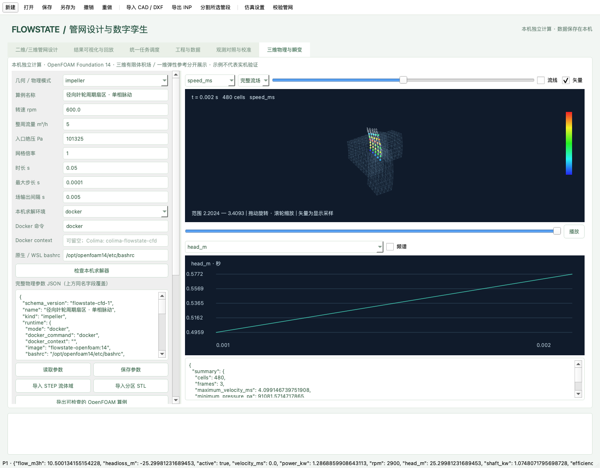
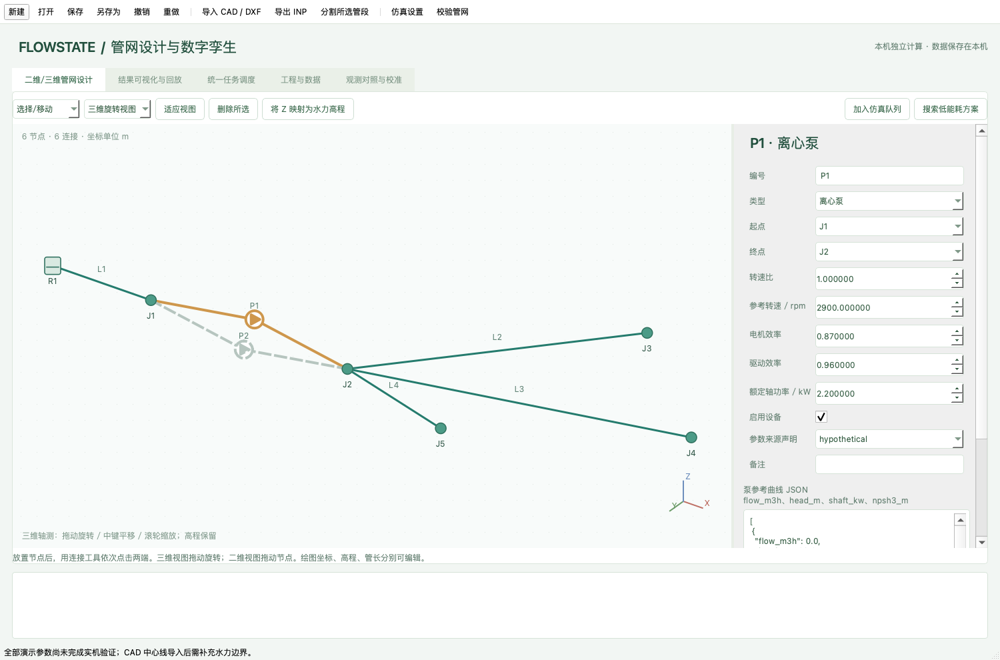

# FLOWSTATE · 离心泵与二维/三维管网


**v2 本机物理工作台已加入三维旋转流动、压力脉动、两相汽蚀扬程下降与管网水锤。**

- [三维模型、CAD 流域、双向耦合和适用边界](docs/PHYSICS.md)
- [本机安装、离线 OpenFOAM 镜像与 GUI 使用](docs/CFD_INSTALL.md)
- [实际数值校核与尚未完成的实机验证](docs/VERIFICATION.md)



原有二维/三维管网设计和中心线 DXF 导入保留。新的 STEP/STL 导入针对封闭 CFD 流体域，二者不能互相替代。所有计算在下载后的电脑独立执行。

**在自己的电脑上设计管网、导入 CAD、运行仿真和查看结果。全部计算与数据存储均在本机完成。**

[下载可直接运行的应用](https://github.com/arcueid11111/energy-system-course-project/releases/latest) · [详细操作](docs/USER_GUIDE.md) · [模型与验证](docs/MODEL.md)



## 下载后直接使用

到右侧 **Releases** 或上方下载链接，选择系统对应的文件，解压后启动。无需另行安装 Python、Qt、EPANET 或 CAD 软件。

| 电脑 | 下载文件 | 启动方法 |
|---|---|---|
| Windows x64 | `Flowstate-windows-x64.zip` | 解压后运行 `Flowstate/Flowstate.exe`，保留整个文件夹 |
| Apple Silicon Mac | `Flowstate-macos-arm64.zip` | 解压后打开 `Flowstate.app` |
| Linux x64 | `Flowstate-linux-x64.tar.gz` | 解压后运行 `./Flowstate/Flowstate` |

应用未购买商业代码签名证书，首次打开可能需要操作系统的来源确认。发布包按平台分别构建，不跨架构混用。发行版中包含第三方组件的许可说明。

> GitHub 的 **Code → Download ZIP** 是源码；如果希望免安装 Python，请下载 **Releases** 中对应的应用包。

## 可以做什么

- **二维设计**：放置水源、需水节点、水箱；连接管道、泵、阀门；编辑参数、分割管段、增设支路和环路；撤销/重做。
- **三维可视化**：保留 XYZ 坐标，旋转、缩放和查看节点压力、管道流量；几何 Z 与水力高程分别保存。
- **DXF 导入**：选择中心线图层、确认单位与连接容差；支持三维折线、图块变换、弧线和样条离散；异高程交叉不误接。
- **独立水力计算**：EPANET 2.2、Darcy–Weisbach 管阻、压力驱动需求；分别计算实际供水、缺口和能耗。
- **统一调度**：仿真、批量扫描、优化和校准任务排队；暂停后续任务、申请取消、保存与重新读取结果。
- **结果分析**：时间回放、泵 Q–H 工作点、方案比较、观测残差和单泵曲线校准。
- **文件交付**：工程 JSON、完整结果 JSON、时序 CSV 和 EPANET INP。

**CAD 当前直接支持 DXF。DWG 请先另存为 DXF。** 实体外观不会自动变成水力模型，导入后仍需确认水源、管径、用水量及设备曲线。

## 五分钟开始

1. 启动后可直接使用内置三维泵网示例，也可打开 `examples/editable_network.json`。
2. 在“二维/三维管网设计”选中设备，修改右侧参数，点击“应用参数”。
3. 点击“加入仿真队列”。在“统一任务调度”选择已完成任务，点击“查看任务结果”。
4. 拖动时间轴查看压力、流量和功率；点击结果图中的泵查看其性能曲线。
5. 保存工程，或导出 JSON、CSV、INP。

CAD 练习文件：`examples/cad_3d_centerline_demo.dxf`，单位毫米，选择 `PIPE_CENTERLINE` 图层。该文件仅含几何，导入后需指定水源和需水量。

## 从源码运行

建议 Python 3.12（支持 3.11–3.13）：

```sh
python -m venv .venv
# Windows: .venv\Scripts\activate
# macOS/Linux: source .venv/bin/activate
python -m pip install -r requirements.txt
python gui.py
```

Windows 也可使用 `start.bat`；macOS/Linux 使用 `start.sh` 或 `启动图形界面.command`。首次源码安装需要下载依赖，安装完成后可断网计算。

```sh
python gui.py --project examples/editable_network.json
python gui.py --data-dir /your/workspace
```

运行记录默认存于系统用户应用数据目录，不写回应用安装位置。源代码、发行包及 GUI 均不含远程服务或账号连接功能。

## 开发与构建

```sh
python -m pip install -r requirements-dev.txt
python -m pytest -q
python gui.py --self-check reports/self-check.json
python scripts/build_app.py
```

`--self-check` 使用 Qt 离屏平台，检查内置求解器、CAD 和真实 GUI 控件，不显示桌面窗口。`scripts/build_app.py` 会打包当前操作系统的完整应用，并运行打包后程序自检，通过后才生成发行压缩包。

跨平台应用通过仓库的 **Build standalone offline apps** 工作流构建并发布；每个平台均先测试，再执行打包程序自检。

## 代码结构

```text
gui.py                  桌面入口
backend/models.py       工程文档与参数校验
backend/physics.py      唯一水力计算内核
backend/cad.py          DXF 中心线与三维拓扑
backend/jobs.py          仿真、优化和校准任务
backend/observations.py  测点映射与单参数校准
backend/dispatch.py      本机持久化队列
backend/store.py         运行结果存储
desktop/                Qt 画布、界面与控制器
examples/               示例工程、CAD、合成观测
packaging/              独立应用打包配置
```

## 科学适用范围

当前为教学/研究用机理仿真原型，示例参数为假设值；未完成真实泵和现场管网的独立验证。数值收敛、内部守恒和合成参数恢复不能代替实机验证。v2 已加入独立的弹性水锤、三维流场和两相汽蚀研究路径，适用范围及校核状态见 docs/PHYSICS.md、docs/VERIFICATION.md；尚不包含轴承寿命预测或设备自动控制，自定义优化也未完成经验证的 NPSH 约束校核。

原始代码采用 MIT 许可证；第三方组件遵循各自许可证，详见 [THIRD_PARTY_NOTICES.md](THIRD_PARTY_NOTICES.md)。
